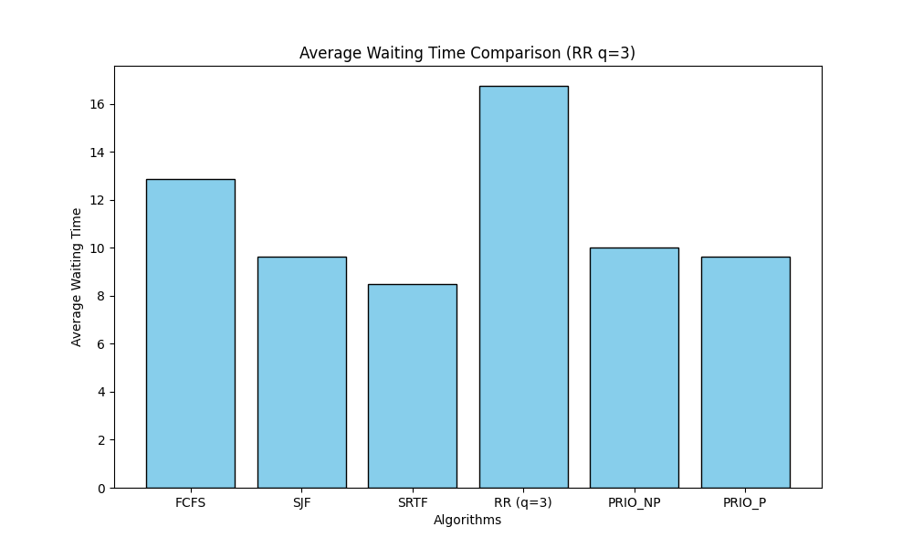
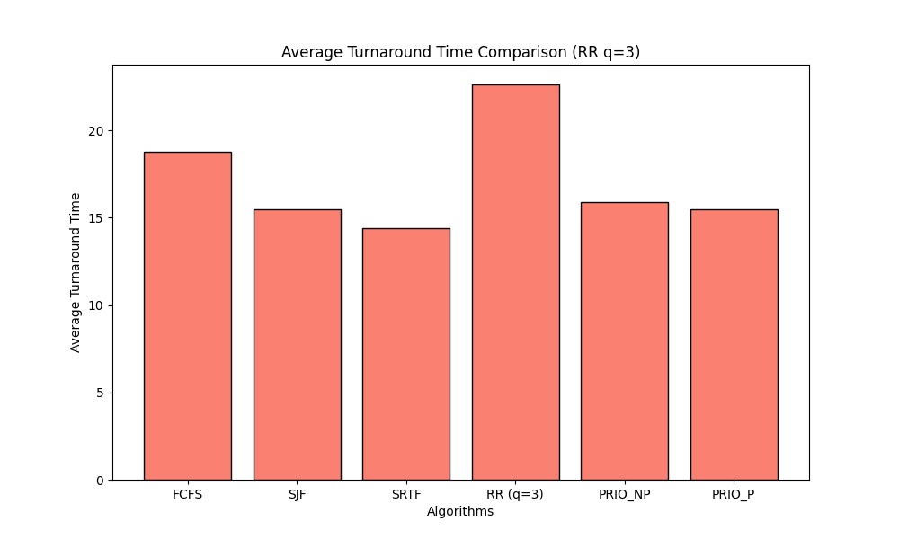

# Modular CPU Process Scheduling Simulator


A modular, deterministic **CPU Process Scheduling Simulator and Benchmarking Suite** written in Python. It models six classical operating system scheduling policies—both non-preemptive and preemptive—generating **ASCII Gantt timelines**, **tick-accurate execution event logs** (arrivals, dispatches, preemptions, resumptions, quantum expirations, completions), **per-process performance metrics**, and **comparative Matplotlib bar charts**.

---

## Supported Scheduling Algorithms

All algorithms enforce **deterministic tie-breaking** (secondary sort by arrival time and alphabetical `PID`) and isolate process state across benchmark runs.

| CLI Flag | Algorithm | Mode | Selection Policy | Tie-Breaking Order | Key Trade-Off |
| :--- | :--- | :--- | :--- | :--- | :--- |
| `FCFS` | **First-Come, First-Served** | Non-Preemptive | Earliest `arrival_time` | `arrival` $\rightarrow$ `pid` | Zero starvation; susceptible to the **convoy effect** behind CPU-bound jobs |
| `SJF` | **Shortest Job First** | Non-Preemptive | Minimum total `burst_time` | `burst` $\rightarrow$ `pid` | Minimizes average waiting time among non-preemptive policies; risk of starving long jobs |
| `SRTF` | **Shortest Remaining Time First** | Preemptive | Minimum `remaining_time` | `remaining` $\rightarrow$ `arrival` $\rightarrow$ `pid` | Provably optimal **Average Waiting Time**; incurs preemption context-switch overhead |
| `RR` | **Round Robin** | Preemptive | FIFO circular queue with fixed time slice `q` | Arrival order (`arrival` $\rightarrow$ `pid`) | Fair CPU sharing and low **Response Time**; high context-switch count if `q` is too small |
| `PRIO_NP` | **Priority Scheduling** | Non-Preemptive | Lowest numeric `priority` value (higher urgency) | `priority` $\rightarrow$ `arrival` $\rightarrow$ `pid` | Honors workload criticality without mid-burst preemption |
| `PRIO_P` | **Preemptive Priority** | Preemptive | Lowest numeric `priority` value; preempts on arrival | `priority` $\rightarrow$ `arrival` $\rightarrow$ `pid` | Immediate dispatch for urgent arrivals; tracks preempt & resume lifecycle events |

> **Priority Convention:** Lower integer values represent higher priority (e.g., Priority `1` preempts Priority `2`).

---

## Metrics Tracked

For every completed process $P_i$, the simulator computes:
- **Turnaround Time ($\text{TAT}$):** $\text{Completion Time} - \text{Arrival Time}$
- **Waiting Time ($\text{WT}$):** $\text{Turnaround Time} - \text{Burst Time}$
- **Response Time ($\text{RT}$):** $\text{First CPU Start Time} - \text{Arrival Time}$
- **Total Context Switches:** Number of CPU transitions between distinct active processes.

---

## Repository Structure

```text
cpu-scheduling-simulator-py/
├── scheduler.py                 # Single-algorithm CLI runner (Gantt chart, event log, stats table)
├── compare.py                   # Multi-algorithm benchmark runner & summary table generator
├── plot.py                      # Matplotlib chart generator for Waiting & Turnaround times
├── algorithms/
│   ├── fcfs.py                  # First-Come, First-Served
│   ├── sjf.py                   # Shortest Job First (Non-Preemptive)
│   ├── srtf.py                  # Shortest Remaining Time First (Preemptive)
│   ├── rr.py                    # Round Robin (Time-Quantum Preemptive)
│   ├── priority_np.py           # Priority Scheduling (Non-Preemptive)
│   └── priority_p.py            # Priority Scheduling (Preemptive)
├── utils/
│   ├── parser.py                # Workload file parser (# comments & whitespace handling)
│   ├── gantt.py                 # ASCII Gantt chart renderer (with automatic IDLE block detection)
│   └── statistics.py            # TAT / WT / RT calculator & formatted CLI table printer
├── examples/                    # UTF-8 sample execution logs for all 6 algorithms & benchmark
├── graphs/                      # Generated comparative charts (waiting.png, turnaround.png)
├── screenshots/                 # Terminal execution captures
├── processes.txt                # Primary 8-process mixed-burst benchmark workload
├── input1.txt                   # Compact 5-process validation workload
├── requirements.txt             # Optional plotting dependency (matplotlib>=3.7.0)
└── LICENSE
```

---

## Quick Start

### 1. Installation

The core simulator (`scheduler.py` and `compare.py`) runs purely on the **Python 3.10+ standard library**. Install `matplotlib` only if you want to regenerate visual charts via `plot.py`:

```bash
git clone https://github.com/berkeC9/cpu-scheduling-simulator-py.git
cd cpu-scheduling-simulator-py
pip install -r requirements.txt
```

### 2. Workload Input Format

Workload files (`processes.txt`, `input1.txt`) use a clean, whitespace-separated 4-column format supporting `#` comments:

```text
# pid  arrival_time  burst_time  priority
P1     0             8           2
P2     1             4           1
P3     2             9           3
P4     3             5           2
P5     10            2           1
P6     12            6           3
P7     15            3           2
P8     20            10          4
```

### 3. Run an Individual Scheduling Policy

```bash
# Non-preemptive policies
python scheduler.py --input processes.txt --algo FCFS
python scheduler.py --input processes.txt --algo SJF
python scheduler.py --input processes.txt --algo PRIO_NP

# Preemptive policies
python scheduler.py --input processes.txt --algo SRTF
python scheduler.py --input processes.txt --algo PRIO_P
python scheduler.py --input processes.txt --algo RR --quantum 3
```

### 4. Benchmark All Policies & Generate Charts

```bash
# Run side-by-side comparison across all 6 algorithms
python compare.py --input processes.txt --quantum 3

# Generate comparative bar charts in graphs/
python plot.py --input processes.txt --quantum 3
```

---

## Sample CLI Output (`PRIO_P` on `processes.txt`)

```text
------------------------------------------------------------------------------------------------------
Simulation Started: PRIO_P 

Gantt Chart: 
| P1 | P2 | P1 | P5 | P1 | P4 | P7 | P3 | P6 | P8 |
0    1    5   10   12   14   19   22   31   37   47

Execution Log: 
t=0: P1 arrives [Prio:2]
t=0: P1 starts running
t=1: P2 arrives [Prio:1]
t=1: P2 preempts P1
t=1: P2 starts running
t=2: P3 arrives [Prio:3]
t=3: P4 arrives [Prio:2]
t=5: P2 completes
t=5: P1 resumes
t=10: P5 arrives [Prio:1]
t=10: P5 preempts P1
t=10: P5 starts running
t=12: P5 completes
t=12: P6 arrives [Prio:3]
t=12: P1 resumes
t=14: P1 completes
t=14: P4 starts running
t=15: P7 arrives [Prio:2]
t=19: P4 completes
t=19: P7 starts running
t=20: P8 arrives [Prio:4]
t=22: P7 completes
t=22: P3 starts running
t=31: P3 completes
t=31: P6 starts running
t=37: P6 completes
t=37: P8 starts running
t=47: P8 completes

Final Statistics: 
PID   Arr   Burst   Compl   TAT   WT    RT   
--------------------------------------------------
P1    0     8       14      14    6     0    
P2    1     4       5       4     0     0    
P3    2     9       31      29    20    20   
P4    3     5       19      16    11    11   
P5    10    2       12      2     0     0    
P6    12    6       37      25    19    19   
P7    15    3       22      7     4     4    
P8    20    10      47      27    17    17   

Summary: 
Average Turnaround Time : 15.50
Average Waiting Time    : 9.62
Average Response Time   : 8.88
Total Context Switches  : 9
```

---

## Benchmark Comparison (`processes.txt`, `RR q=3`)

```text
Algorithm       Avg TAT    Avg WT     Avg RT     Ctx Switch
------------------------------------------------------------
FCFS            18.75      12.88      12.88      7         
SJF             15.50      9.62       9.62       7         
SRTF            14.38      8.50       6.00       8         
RR (q=3)        22.62      16.75      6.88       15        
PRIO_NP         15.88      10.00      10.00      7         
PRIO_P          15.50      9.62       8.88       9         
```

### Visual Performance Charts

| Average Waiting Time | Average Turnaround Time |
| :---: | :---: |
|  |  |

### Key Analytical Takeaways
- **SRTF** achieves both the lowest **Average Waiting Time (`8.50`)** and lowest **Average Turnaround Time (`14.38`)**, plus the fastest **Average Response Time (`6.00`)**, at the cost of only 1 extra context switch over non-preemptive policies.
- **Round Robin (`q=3`)** keeps **Average Response Time (`6.88`)** nearly as low as SRTF (preventing interactive starvation), while incurring higher turnaround time (`22.62`) and context-switching overhead (`15` switches) as jobs cycle through the ready queue.
- **FCFS** suffers from the classic convoy effect behind early longer bursts (`P1`, `P3`), yielding higher average waiting time (`12.88`) than `SJF` (`9.62`) and `PRIO_P` (`9.62`).

---

## License

Released under the [MIT License](LICENSE). Copyright (c) 2026 Berke Cinkol.
